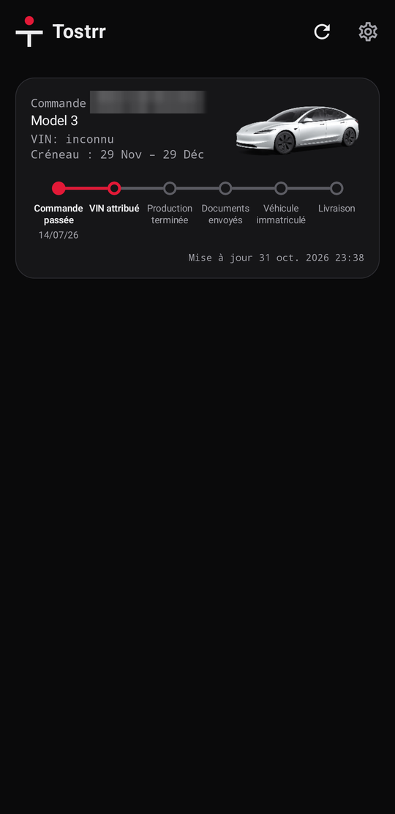
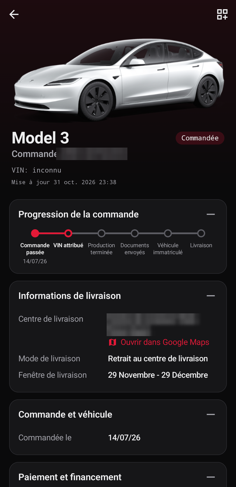
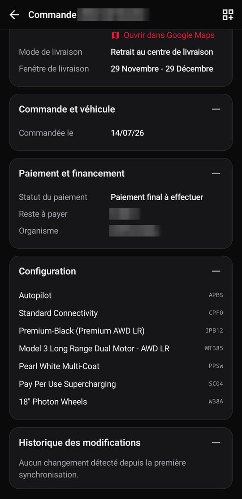
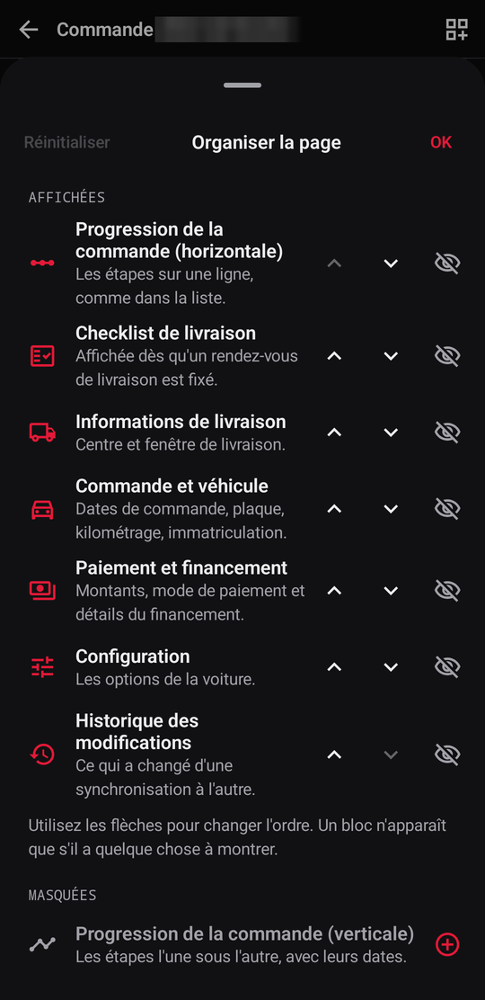
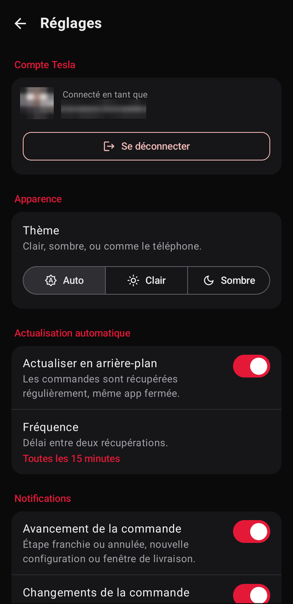
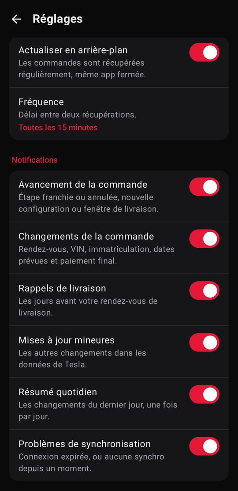
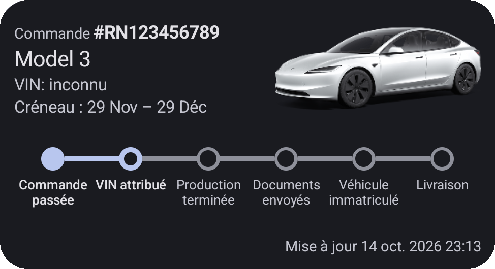
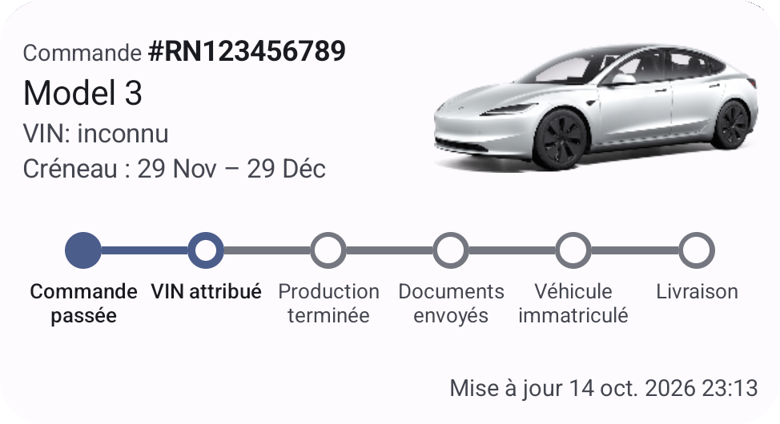
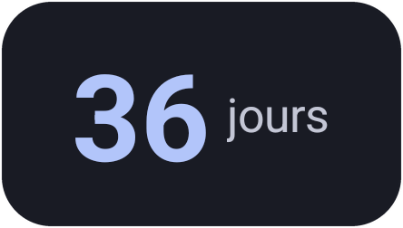

# Tostrr

**A clean, private tracker for your Tesla order: from "order placed" to the keys in your hand.**
For Android 8.0 and later.

> [!IMPORTANT]
> **Tostrr is an unofficial community app. It is not made, endorsed or supported by Tesla, Inc.**
>
> It reads your order through the same undocumented endpoints the Tesla app uses, with your own Tesla account. Tesla can change or close them at any time, and some steps are inferred rather than given by Tesla. See [Disclaimer](#disclaimer).

Tostrr signs in to your Tesla account, checks your orders in the background and tells you the moment something moves: a VIN, a delivery window, a plate, an appointment. It keeps a history of every change Tesla makes to your order, puts the countdown on your home screen, and walks you through the inspection on delivery day. It **only reads** your order: it never changes, cancels or pays for anything.

<p align="center">
  
  
  
</p>
<p align="center">
  
  
  
</p>
<p align="center">
  
</p>
<p align="center">
  
  
</p>

---

## Table of contents

1. [What you get](#what-you-get)
2. [How it works](#how-it-works)
3. [What you need](#what-you-need)
4. [Installing Tostrr](#installing-tostrr)
5. [Signing in](#signing-in)
6. [Notifications](#notifications)
7. [The delivery-day checklist](#the-delivery-day-checklist)
8. [Privacy & security](#privacy--security)
9. [Build from source](#build-from-source)
10. [Under the hood](#under-the-hood)
11. [License](#license)
12. [Disclaimer](#disclaimer)

---

## What you get

* **Every order at a glance**: model, picture, reference, VIN and a six-step progress bar, from *Order placed* to *VIN assigned*, *Production finished*, *Documents sent*, *Vehicle registered* and *Delivery*.
* **A detailed order page**: delivery centre (with a map link) and window, appointment, order dates, plate and mileage, amounts, payment method and financing, and the configuration with readable option names. **Reorder, hide or collapse** each block to make the page yours.
* **Change history**: every sync is compared with the previous one, so you see exactly what Tesla changed and when, even the fields nothing else reports.
* **Notifications** for each step, each change to your order, delivery reminders, a daily summary and sync problems. [Choose which ones](#notifications) in the settings.
* **Home-screen widgets**: an **order widget** with the car, its progress and the delivery window, and a **countdown widget** to delivery day. Each follows the app's light or dark theme.
* **Delivery-day checklist**: 81 checks in five sections, each with an optional comment and photo, saved per order on your phone.
* **Background sync** every 15 or 30 minutes, every 1, 2 or 6 hours, or only when you refresh.
* **Launcher shortcuts** to your latest orders still awaiting delivery.
* **Light, dark or like your phone**, in **English and French**, with dates and amounts written your phone's way.

---

## How it works

Tesla shows your order in its own app through a handful of undocumented endpoints. Tostrr signs in with your Tesla account exactly like the Tesla app does, then reads the same data.

```
        Your Tesla account ──▶ Tesla order API ──▶ 📱 Tostrr ──┬──▶ Order screens & history
                                                              ├──▶ Notifications
                                                              └──▶ Home-screen widgets
```

On every sync, Tostrr:

1. fetches your orders and, for each one, its tasks (registration, financing, delivery, final payment…);
2. turns them into steps and dates, looking for each date wherever Tesla happens to put it this week;
3. compares the result with the previous sync and records each change in the order's history;
4. posts a notification for what matters, and redraws the widgets.

Nothing goes through a third-party server: your phone talks to Tesla directly (crash reports aside, see [Privacy & security](#privacy--security)).

---

## What you need

* An **Android phone** running Android 8.0 (API 26) or later.
* A **Tesla account** with at least one order.

You do **not** need a Tesla developer account, a Fleet API key, a server or any paid service.

---

## Installing Tostrr

Tostrr isn't on the Play Store. Each version is published as a signed APK on the [Releases](https://github.com/ArnaudPiroelle/tostrr/releases) page:

1. On your phone, download `tostrr-<version>.apk` from the [latest release](https://github.com/ArnaudPiroelle/tostrr/releases/latest).
2. Open it. Android asks once to allow installing apps from your browser or file manager: allow it, then tap **Install**.
3. Later versions install over it the same way and keep your data.

> Every release is signed with the same key, so an update always installs over the previous one. A build you made yourself is signed with your own debug key: uninstall it before installing a release.

Or [build it from source](#build-from-source).

---

## Signing in

1. Open Tostrr and tap **Sign in with Tesla**. Tesla's own sign-in page opens in a browser tab.
2. Sign in as usual, two-factor code included. Tostrr never sees your password.
3. Tesla sends you back to the app, which fetches your orders straight away.

> 💡 If your browser doesn't bring you back (you see a "page not found" on an address starting with `tesla://auth/callback`), tap **Redirect not working?**, then paste that address: it finishes the sign-in the same way.

The session is renewed in the background. If Tesla ends it, Tostrr tells you with a notification so you can sign in again.

---

## Notifications

Every kind can be turned on or off in **Settings → Notifications**, and each has its own Android channel, so you can also change its sound or importance in the system settings.

| Notification | When it fires |
|---|---|
| **Order progress** | A step is done (or, rarely, undone), the configuration changes, or a new delivery window appears. |
| **Order changes** | The appointment is set, moved or cancelled; the VIN or plate changes; the expected arrival or registration date moves; the final invoice is ready or the final payment is received. |
| **Delivery reminders** | Three days before your appointment, then the day before, with what to bring: ID, insurance, final payment if still due. |
| **Minor updates** | Tesla changed something no other notification covers; lists the fields. |
| **Daily summary** | Once a day, after 9:00, when something changed: "3 changes in 2 orders". |
| **Sync problems** | The Tesla sign-in expired, or no sync has succeeded for a while. |

> Notifications need background sync, unless you refresh by hand. Turning a kind off doesn't replay old news when you turn it back on.

---

## The delivery-day checklist

Delivery day is short and busy. The checklist turns up on the order page once an appointment is set and takes you through **81 checks in five sections**:

| Section | Checks |
|---|---|
| Exterior | 26 |
| Interior | 14 |
| Software | 14 |
| Mechanical | 18 |
| Accessories | 9 |

One screen per check: mark it **checked** or **skip** it, with a comment or a **photo** if needed (taken on the spot or picked from the gallery). You can stop and pick up where you left off; answers and photos stay on your phone, per order.

---

## Privacy & security

* **Read-only.** Tostrr only reads your orders. It contains nothing that could change, cancel or pay for an order, or control a car.
* **Your phone talks to Tesla, and nobody else but Crashlytics.** No account, no analytics, no ads, no Tostrr server. The only other requests are to fetch Tesla's car pictures and, best effort, readable option names from [tesla-order-status-tracker.de](https://www.tesla-order-status-tracker.de) (option codes only, nothing about you).
* **Crash reports are the only tracking.** Released builds use [Firebase Crashlytics](https://firebase.google.com/products/crashlytics): when the app crashes it sends the stack trace, the phone model, the Android and app versions; on each launch it also sends a session ping with a random Firebase installation ID, so the crash-free rate can be computed. Never your Tesla account, tokens or order data. Builds from source send nothing unless you add your own `app/google-services.json`.
* **No password stored.** You sign in on Tesla's own page; Tostrr only keeps the tokens Tesla gives it, **encrypted with a key held in the Android Keystore**.
* **No cloud backup.** The app's data is excluded from Android backups. Signing out removes your tokens, your account details, your cached orders and their history from the phone.

---

## Build from source

```bash
# Requirements: JDK 21 and the Android SDK (or Android Studio)
git clone https://github.com/ArnaudPiroelle/tostrr.git
cd tostrr
./gradlew :app:assembleDebug        # builds app/build/outputs/apk/debug/app-debug.apk
./gradlew :app:installDebug         # installs it on the connected phone
```

With more than one device connected, pick one with `ANDROID_SERIAL=<serial>`.

Run the tests, all on the JVM:

```bash
./gradlew :domain:test :data:testDebugUnitTest :app:testDebugUnitTest
```

---

## Under the hood

Kotlin, **Jetpack Compose** (Material 3), **Glance** widgets, WorkManager, Room, OkHttp, kotlinx.serialization, Navigation 3 and Koin.

| Module | What it holds |
|---|---|
| `:domain` | Pure Kotlin: the order model, how Tesla's JSON becomes steps and dates, the change history, the alert rules, the checklist, and the use cases. No Android. |
| `:data` | Sign-in, the Tesla API, storage, notifications and the background sync. |
| `:app` | The Compose screens and their ViewModels, the widgets and the shortcuts. |

Tesla doesn't document when steps like *Production finished*, *Documents sent* or *Vehicle registered* happen. Those rules are educated guesses, kept apart in the step detectors so they can be corrected as real orders reach those steps.

---

## License

Copyright © 2026 Arnaud Piroelle.

Tostrr is free software: you can redistribute it and/or modify it under the terms of the **GNU General Public License, version 3 or (at your option) any later version** ([GPL-3.0-or-later](LICENSE)), as published by the Free Software Foundation. It is distributed in the hope that it will be useful, but **without any warranty**; without even the implied warranty of merchantability or fitness for a particular purpose. See the [LICENSE](LICENSE) file for the full text.

If you distribute a modified version of Tostrr, the GPL requires you to offer its source code under the same license.

The bundled list of delivery centres (`data/src/main/assets/delivery_centers.json`) is a snapshot of public information from tesla.com and is not covered by this license. The libraries Tostrr is built with keep their own licenses.

---

## Disclaimer

> Tostrr is an unofficial community app. It is not made, endorsed or supported by Tesla, Inc.

* **Unofficial app.** Tostrr is an independent project, **not affiliated with, endorsed by, sponsored by, or related in any way** to Tesla, Inc.
* **Undocumented API.** Tostrr uses the same endpoints as the Tesla app. Tesla doesn't document them and can change or close them at any time, which may break Tostrr without warning.
* **Inferred progress.** Some steps and dates are deduced from what Tesla returns and may be early, late or wrong. **The Tesla app and your Tesla advisor remain the reference** for your order, your appointment and your payments.
* **Trademarks.** "Tesla", "Model 3", "Model Y" and the Tesla logo are trademarks of Tesla, Inc. They are used only to describe what the app works with and do not imply any partnership or endorsement.
